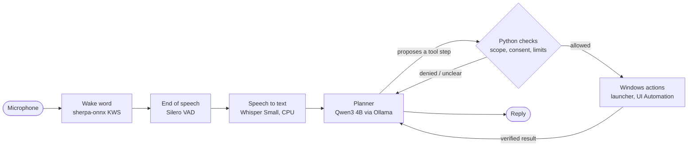

# Aqua

**A private, hands-free AI assistant for Windows that runs entirely on your own PC, including mid-range laptops.**

Say *"Hey Aqua"* and talk to it. Aqua listens, understands and acts on your computer using only local models.
No cloud, no account, no telemetry, and nothing you say is saved.

[](https://github.com/PradyumnaSupatkar/AQUA/actions/workflows/tests.yml)


> **Status: early development (v0.8).** The voice pipeline, local conversation and a small set of carefully
> checked desktop actions work today. Broader Windows control, spoken replies and multi-step tasks are in progress;
> see the [roadmap](#roadmap). Setup is currently manual.

---

## Why Aqua

Most voice assistants send your audio to the cloud, and most local AI tools assume a high-end GPU. Aqua is built
for people who want privacy **and** don't own a high-end PC. The current minimum target is a
**Ryzen 7 4800H laptop with an RTX 3050 (4 GB VRAM) and 16 GB of RAM**.

## What works today

- **Hands-free activation:** an offline "Hey Aqua" wake word runs on the CPU. Voice activity detection decides
  when you've finished speaking.
- **Offline speech recognition:** Whisper Small (faster-whisper, CPU INT8) with in-memory audio only.
- **Local conversation:** Qwen3 4B Instruct through [Ollama](https://ollama.com) on `127.0.0.1`, with streaming
  replies and session memory that is never written to disk.
- **Desktop actions:** the model chooses its own tool steps (up to five per task), and Python checks each one:
  - open approved apps (Notepad, Calculator, VS Code, Chrome)
  - list and inspect their windows through Windows UI Automation, and describe what is actually there
  - write exact text into an empty Notepad document (opt-in), verified by reading it back
- **Three ways to use it:** typed chat, push-to-talk voice and fully hands-free, all sharing one controller.
- **Measured, not assumed:** 1020 offline tests, plus frozen benchmarks for
  [model choice](benchmarks/model_intelligence/REPORT.md) and
  [intent safety](benchmarks/semantic-intent-v1/report.md).

**Not yet:** spoken replies, launching any installed app, system controls (volume, power), file and editor
tasks, or longer multi-step plans. These are the next milestones. The speech output code (playback, interruption,
follow-up questions) now exists and is tested, but no voice is installed yet, so replies are still text-only.

## How it works



The model interprets what you want and proposes each step. Trusted Python code independently decides whether the
step may run, executes it, and reports only verified results back. A confident model can never grant itself
permission.

## Privacy

- Audio, transcripts and conversation history stay in process memory and are never saved.
- Speech recognition and the wake word make no network requests.
- The model is reached only at `http://127.0.0.1:11434`: no remote host, proxy or cloud fallback.
- Hugging Face and ONNX Runtime telemetry are disabled.
- Aqua never downloads models on its own. Downloads happen only through explicit setup commands.

## Quick start

Requirements: Windows 11, Python 3.12, [Ollama](https://ollama.com), a microphone, and about 4 GB of free disk space.

```powershell
git clone https://github.com/PradyumnaSupatkar/AQUA.git
cd AQUA
py -3.12 -m venv .venv
.\.venv\Scripts\python.exe -m pip install -e ".[desktop]"

# Local models (one-time downloads)
ollama pull qwen3:4b-instruct-2507-q4_K_M
.\.venv\Scripts\python.exe -m aqua setup-model --model small --download
.\.venv\Scripts\python.exe -m aqua setup-wake --download
```

Then, with Ollama running:

```powershell
.\.venv\Scripts\python.exe -m aqua chat                                   # typed
.\.venv\Scripts\python.exe -m aqua voice-chat --language en               # press Enter to talk
.\.venv\Scripts\python.exe -m aqua handsfree --language en --hints         # say "Hey Aqua, open Notepad"
```

Add `--allow-text-entry notepad` to let Aqua write into an **empty** Notepad window you opened, and `--diagnostics`
for timings. Run any command with `--help` for all options. The
[detailed reference](docs/reference-v0.8.md) covers microphones, models, tuning and troubleshooting.

## Roadmap

1. **Spoken replies:** natural local text-to-speech (Kokoro), spoken yes/no confirmations, "stop" to interrupt.
   *In progress:* the speech output pipeline is written and tested with a stand-in engine; installing real voices
   and benchmarking them comes next.
2. **Windows control by risk level:** launch any installed app, window management, volume, brightness, media,
   and power. Safe actions just happen, reversible ones can be undone, and disruptive or destructive ones
   (shutdown, delete, send) always ask first.
3. **Multi-step tasks:** plan → act → verify loops with file, VS Code and browser support. For example: *"Open
   VS Code, open my project, and add a semicolon at the end of line 62."*
4. **Evaluation:** a public task suite measuring success rate, unwanted actions and latency on the minimum hardware.
5. **Release:** a one-click installer that detects your hardware and sets up the models.

## Development

```powershell
.\.venv\Scripts\python.exe -B tools\test_offline.py     # 1020 tests, ~5 s; network and process launches blocked
```

The tests need no microphone, Ollama or models, and run on every push via GitHub Actions. Stage reports are in
[`docs/`](docs/) and version history is in the [changelog](CHANGELOG.md).

```text
src/aqua/
  audio/     capture, streaming, voice activity detection, microphone diagnostics
  wake/      offline "Hey Aqua" keyword detection
  speech/    Whisper models, recognition, vocabulary hints
  brain/     Ollama client, conversation controller, intent and consent checks
  actions/   tool definitions, app launcher
  desktop/   Windows UI Automation observation and text entry
  benchmark/ model evaluation harness
tests/       offline unit tests      tools/   smoke tests and benchmark scripts
docs/        stage reports           benchmarks/   frozen datasets and results
```

## License

[Apache-2.0](LICENSE). Models are downloaded separately and keep their own licences.
Third-party components and voice licences are listed in [THIRD_PARTY_NOTICES.md](THIRD_PARTY_NOTICES.md).
